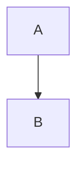

# Diagrams

All diagrams are provided as both Mermaid source (`.mmd`) and rendered PNG (`.png`).

## Diagram Index

| File | Title | Phase(s) |
|---|---|---|
| `01_design_cycle` | The Iterative Design Cycle | All |
| `02_phase_timeline` | Phase Overview Timeline | All |
| `03_governance_structure` | Governance Roles and Artefacts | Phase 0 |
| `04_taxonomy_reification` | Taxonomy–Reification Decision Flow | Phase 3 |
| `05_shape_composition` | Abstract Shape Composition Patterns | Phase 5 |
| `06_validation_loop` | Validation Feedback Routing | Phase 6 |
| `07_llm_guardrails` | LLM Integration Points and Guard Rails | Phases 2, 4, 7 |
| `08_imports_architecture` | `owl:imports` Module Architecture | Phase 1, 5 |

## Using the Mermaid Source

Mermaid diagrams can be rendered in several ways:

**VS Code** — Install the [Mermaid Preview](https://marketplace.visualstudio.com/items?itemName=bierner.markdown-mermaid) extension. `.mmd` files preview inline.

**GitHub** — Mermaid diagrams embedded in Markdown render automatically in GitHub's viewer:
````markdown

````

**Mermaid Live Editor** — Paste `.mmd` content at [mermaid.live](https://mermaid.live) for interactive editing.

**CLI rendering** — Requires `@mermaid-js/mermaid-cli`:
```bash
npm install -g @mermaid-js/mermaid-cli

# Render single diagram
mmdc -i 01_design_cycle.mmd -o 01_design_cycle.png -w 1400 -b white

# Render all diagrams
for f in *.mmd; do
  mmdc -i "$f" -o "${f%.mmd}.png" -w 1400 -b white
done
```

> **Note for Linux root environments:** mmdc requires `--no-sandbox` for Chromium. Create a `puppeteer_config.json`:
> ```json
> { "args": ["--no-sandbox", "--disable-setuid-sandbox"] }
> ```
> Then add `--puppeteerConfigFile puppeteer_config.json` to the `mmdc` command.

## Adding Diagrams to Documentation

The Mermaid `.mmd` files are designed to be embedded directly in Markdown documents. To include a diagram in your own documentation:

```markdown
## Design Cycle

The methodology follows an iterative cycle rather than a sequential waterfall.


*See [01_design_cycle.mmd](diagrams/01_design_cycle.mmd) for the source.*
```

## Customising Diagrams for Your Project

The diagrams use a consistent colour scheme:
- **Navy `#1F4E79`** — foundational/owner-level elements
- **Blue `#2E75B6`** — cycle phases and structural elements  
- **Light blue `#D6E4F0`** — informational/supporting elements
- **Orange `#E05A00`** — reification and LLM-related elements
- **Red `#C00000`** — failure states and guard rails

To adapt a diagram for a specific project, copy the `.mmd` file, replace entity names and IRI examples, and re-render.
